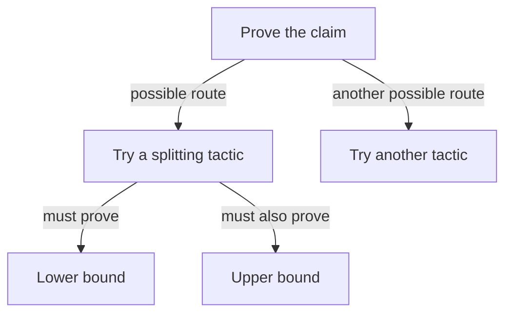

# Can a graph help smaller agents finish proofs?

Reviewed on 2026-11-03. The [Euclid study](../tests/agent-eval/proof-algorithms/README.md)
finished all twenty sessions once. Eight delivered patches passed independent checks;
twelve complete attempts timed out. These prove the fixed executable Lean algorithm,
including termination and correctness, rather than only a supporting arithmetic lemma.

The [review](../tests/agent-eval/proof-algorithms/local-results/review-context.md)
records the exact counts. Luna completed both formats twice; Kimi completed graph
twice and checklist once. GLM completed neither; a confirmed fr reader defect makes
its presentation comparison uncertain. No agent met the two-versus-zero rule for
transfer. These small results establish no general graph advantage. Reversal stays
reserved. Earlier interrupted cohorts remain unchanged.

This review concerns proof-guidance presentation. Code and call graphs remain part of the
[full-product roadmap](../PLAN.md#proposed-pr-sequence), regardless of this presentation result.
Later [page-count results](../tests/agent-eval/proof-page-count/local-results/summary.json) delivered four proofs under a separate 300-second limit.
They do not establish a graph-presentation benefit.

## What the evidence supports

Our [behavior review](../tests/agent-eval/proof-writing/behavior-review.md) records several different obstacles:
agents confuse assumptions joined by “and” with alternatives, search without checking a draft,
apply library facts with the wrong argument types, or fail to finish delivery after a passing proof.
None of the four page-count attempts in that original comparison opened the arithmetic lesson.
Adding more unread instructions cannot establish an improvement.

The [manual error review](../tests/agent-eval/proof-page-count/draft-error-review.json) separates these problems.
Fixing the assumption grouping exposed arithmetic goals. Normalizing a Boolean condition removed one failure.
The unchanged complete claim passed only after the control supplied suitable division facts as well.
These are manual controls, not agent successes or measured speedups. Fewer errors alone did not establish progress.

The twenty-session study used the interactive command and shared skills. It compares
guidance methods, so it cannot isolate the command's effect. Earlier results describe
older tools and instructions.

Research gives useful mechanisms, with important limits:

- [HyperTree Proof Search](https://arxiv.org/html/2205.11491v1) combines checked tactic attempts with a search graph.
  One successful alternative can prove a goal; every child produced by that alternative must be solved.
  Its trained models, search and training budgets differ from our local CLI agents and 150-second task limit.
  Its results do not establish that a diagram alone helps our models.
- [LeanDojo and ReProver](https://arxiv.org/html/2306.15626v2) retrieve relevant library facts and test candidate tactics through Lean.
  They support investigating fact selection and checked search. They do not isolate graph presentation for GLM, Kimi or Luna.
- [Lean Copilot](https://arxiv.org/abs/2404.12534) combines tactic suggestions, fact selection and proof search.
  This supports testing existing automation before building another search system; it does not settle our comparison.
- [Same Text, Different Transitions](https://aclanthology.org/2026.mathnlp-main.18/) reports distinct Lean states that print identically but accept different tactics.
  The paper distinguishes a constructed collision benchmark from rare collisions in blind sampling.
  This is an implementation warning, not an explanation established for our failures.

**Working inference:** relevant facts, small case guides and checked exploration have stronger support than a graph display alone.
A graph remains plausible, but the completed presentation comparison does not justify adopting it as an improvement.

## What a useful graph would mean

A tactic is an instruction that constructs a proof. A goal is a claim still to prove.
Suppose a tactic turns “prove both bounds” into “prove the lower bound” and “prove the upper bound.”
Both children remain necessary. A different tactic is another possible route, not another required child.

The diagram describes a candidate structure, not an accepted proof. Lean must validate each attempted step.
Some goals share unfinished expressions. A search engine must preserve that shared context when returning to an earlier state.
Solving the displayed lower-bound branch cannot mark the whole claim complete.

The current [proof-state implementation](../src/spec/proof_state.rs) returns readable goals at a draft cursor.
It starts an editor query for each inspection; it supplies no restorable Lean execution checkpoint.
Its `goal_id` identifies the original theorem, not a unique search node for each branch.
Its `proof_digest` identifies draft content, not a complete Lean machine state.
Do not merge nodes just because their displayed goals or theorem identifiers match.
Retaining whole draft snapshots could support a prototype that replays drafts.
Its replay cost and step validity would need qualification.
Only a passing complete `fr proof check` can accept the final proof.

## Skills should distinguish these cases

| What the agent sees | What the guide should explain |
| --- | --- |
| Must prove two statements | Split the goal and finish both branches |
| Already knows two facts joined by “and” | Extract both facts; do not invent alternative cases |
| Knows one of two alternative facts | Prove the result separately for each possible case |
| A Boolean condition controls the result | Expose the selected condition and simplify it before arithmetic |
| An integer division bound remains | Find facts for the actual operation and read their argument types |
| Lean accepted the complete draft | Save, run the supplied check, capture the patch and finish once |

The [arithmetic lesson](../skills/fr/references/lean-arithmetic.md) already teaches several of these distinctions.
First measure whether agents read and apply it. Track the selected guide and the next checked action;
opening a file alone is not a successful proof step.
Keep guides small and available at the relevant goal. Do not load every guide or guess an unmatched case.

A workflow graph could track delivery separately from mathematical reasoning.
The [supplied-proof delivery diagnostic](../tests/agent-eval/proof-delivery/README.md)
has finished all twelve fixed slots after native admission. Both setups got correct
drafts; one added a short finish card. Independent checking accepted eleven patches,
but six OpenCode attempts lack complete streamed usage and one Kimi attempt timed
out without a patch. Only five meet all completion requirements. Luna tied across
setups; the GLM/Kimi comparison is unusable. The
[review](../tests/agent-eval/proof-algorithms/local-results/M3-delivery/review.md)
preserves these limits. No graph benefit, card advantage or transfer candidate follows.
The earlier repair diagnostic recorded a GLM proof passing at 66 seconds and its package check at 86 seconds.
Repeated work then consumed the remaining time. A clear “proof accepted, now deliver” phase is worth testing.
Those older instructions had a known defect, so that record does not establish that the current skill still fails.
Require a passing complete check before that transition; a closed cursor branch is insufficient.
Test correct delivery, package failure, changed settings and late completion before trying another model session.
Keep the same delivery guidance in both graph-presentation conditions.

## The fixed experiment and what happens next

The [Euclid report](../tests/agent-eval/proof-algorithms/README.md) retains the original comparison and decision rules.
No agent met its two-versus-zero success rule for transfer, so list reversal stays reserved.
The [division-fact study](../tests/agent-eval/proof-division-facts/README.md) and later page-count studies tested different obstacles.
They do not establish a benefit from graph presentation.

Use the [current roadmap](../PLAN.md#proposed-pr-sequence) for implementation work.
Test a new proof-search controller only if observed failures require it; no recorded state-loss failure currently does.
Keep original outcomes and limits in their reports. The [November review](https://github.com/e6qu/fun-refactor/blob/7666442e9/docs/proof-guidance-review.md)
retains the detailed experiment sequence.
