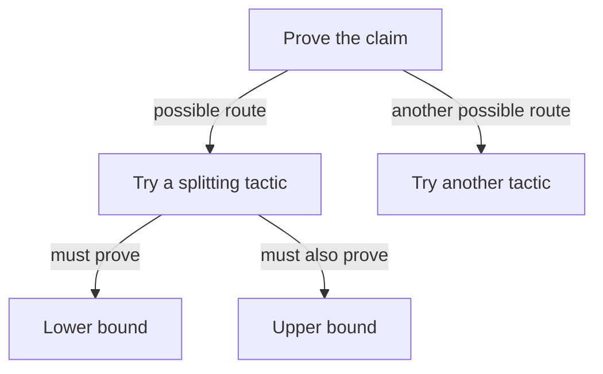

# Can a graph help smaller agents finish proofs?

Reviewed on 2026-11-02 after PR #591 merged. This is a review and experiment plan.
The first five Euclid sessions retain three timeouts, one submitted proof and a memory stop.
The [interrupted batch](../tests/agent-eval/proof-algorithms/interrupted-results/README.md)
exposed reader and resource-monitor defects. It cannot establish a guidance advantage.
The later Init-import attempt also stopped at its memory ceiling. Complete-workflow
checks now precede fresh plans; an initial-goal check was insufficient.
No graph session has run yet.

## What the evidence supports

Our [behavior review](../tests/agent-eval/proof-writing/behavior-review.md) records several different obstacles:
agents confuse assumptions joined by “and” with alternatives, search without checking a draft,
apply library facts with the wrong argument types, or fail to finish delivery after a passing proof.
None of the latest four full page-count attempts opened the arithmetic lesson.
Adding more unread instructions cannot establish an improvement.

The [manual error review](../tests/agent-eval/proof-page-count/draft-error-review.json) separates these problems.
Fixing the assumption grouping exposed arithmetic goals. Normalizing a Boolean condition removed one failure.
The unchanged complete claim passed only after the control supplied suitable division facts as well.
These are manual controls, not agent successes or measured speedups. Fewer errors alone did not establish progress.

The merged interactive command has passed real Lean tests. No complete new comparison isolates its effect yet.
The first baseline must use that command and the current skills. Earlier results describe older tools and instructions.

Research gives useful mechanisms, with important limits:

- [HyperTree Proof Search](https://arxiv.org/html/2205.11491v1) combines checked tactic attempts with a search graph.
  One successful alternative can prove a goal; every child produced by that alternative must be solved.
  Its trained models, search and training budgets differ from our local CLI agents and 150-second task limit.
  Its results do not establish that a diagram alone helps our models.
- [LeanDojo and ReProver](https://arxiv.org/html/2306.15626v2) retrieve relevant library facts and test candidate tactics through Lean.
  They support investigating fact selection and checked search. They do not isolate graph presentation for GLM, Kimi or Luna.
- [Lean Copilot](https://arxiv.org/abs/2404.12534) combines tactic suggestions, fact selection and proof search.
  This supports testing existing automation before building another search system; it does not settle our comparison.
- [Same Text, Different Transitions](https://aclanthology.org/2026.mathnlp-main.18/) reports distinct Lean states that print identically but accept different tactics.
  The paper distinguishes a constructed collision benchmark from rare collisions in blind sampling.
  This is an implementation warning, not an explanation established for our failures.

**Working inference:** relevant facts, small case guides and checked exploration have stronger support than a graph display alone.
A graph remains a plausible way to keep track of unfinished work. Its benefit still needs a controlled test.

## What a useful graph would mean

A tactic is an instruction that constructs a proof. A goal is a claim still to prove.
Suppose a tactic turns “prove both bounds” into “prove the lower bound” and “prove the upper bound.”
Both children remain necessary. A different tactic is another possible route, not another required child.

The diagram describes a candidate structure, not an accepted proof. Lean must validate each attempted step.
Some goals share unfinished expressions. A search engine must preserve that shared context when returning to an earlier state.
Solving the displayed lower-bound branch cannot mark the whole claim complete.

The current [proof-state implementation](../src/spec/proof_state.rs) returns readable goals at a draft cursor.
It starts an editor query for each inspection; it supplies no restorable Lean execution checkpoint.
Its `goal_id` identifies the original theorem, not a unique search node for each branch.
Its `proof_digest` identifies draft content, not a complete Lean machine state.
Do not merge nodes just because their displayed goals or theorem identifiers match.
Retaining whole draft snapshots could support a prototype that replays drafts.
Its replay cost and step validity would need qualification.
Only a passing complete `proof-check` can accept the final proof.

## Skills should distinguish these cases

| What the agent sees | What the guide should explain |
| --- | --- |
| Must prove two statements | Split the goal and finish both branches |
| Already knows two facts joined by “and” | Extract both facts; do not invent alternative cases |
| Knows one of two alternative facts | Prove the result separately for each possible case |
| A Boolean condition controls the result | Expose the selected condition and simplify it before arithmetic |
| An integer division bound remains | Find facts for the actual operation and read their argument types |
| Lean accepted the complete draft | Save, run the supplied check, capture the patch and finish once |

The [arithmetic lesson](../skills/fr/references/lean-arithmetic.md) already teaches several of these distinctions.
First measure whether agents read and apply it. Track the selected guide and the next checked action;
opening a file alone is not a successful proof step.
Keep guides small and available at the relevant goal. Do not load every guide or guess an unmatched case.

A workflow graph could track delivery separately from mathematical reasoning.
The earlier repair diagnostic recorded a GLM proof passing at 66 seconds and its package check at 86 seconds.
Repeated work then consumed the remaining time. A clear “proof accepted, now deliver” phase is worth testing.
Those older instructions had a known defect, so that record does not establish that the current skill still fails.
Require a passing complete check before that transition; a closed cursor branch is insufficient.
Test correct delivery, package failure, changed settings and late completion before trying another model session.
Keep the same delivery guidance in both graph-presentation conditions.

## Test one explanation at a time

1. **Facts and the current baseline.** Use the fixed executable Euclid GCD task in the
   [algorithm study](../tests/agent-eval/proof-algorithms/README.md).
   Prove both termination and correctness. Compare selecting facts with receiving their types in eight GLM/Kimi sessions.
   Qualify the references, evaluator and negative controls first; references stay outside agent workspaces.
   The earlier division-fact plan remains an unrun supporting diagnostic, not a substitute for the algorithm.
2. **Graph presentation.** Use the same fixed Euclid task after the fact comparison.
   Compare a plain checklist with a graph.
   Both contain exactly the same goals, assumptions, facts, dependencies and case guides.
   Both keep the same interactive commands and checking policy. Only presentation changes.
   Use Luna Fast, GLM Flash and Kimi K3, two repetitions per condition: twelve fresh sessions with balanced order.
   Keep the original 150-second complete-attempt limit and workstation limits.
   Reserve accumulator-based list reversal for transfer after the development decisions are fixed.
3. **Checked search, only as a separate question.** If navigation or repeated failed paths remain an observed obstacle,
   compare the agent's existing loop with a bounded controller that retains alternatives and returns to a valid earlier state.
   Keep guidance, available facts, proposed-tactic allowance and total time fixed.
   Include controller work, replay, checks and delivery in the cost. Prove checkpoint and dependency handling before live calls.
   Do not call any improvement from this change evidence for graph formatting.

Before graph sessions, fix the tasks, controller code, exact source and tool versions, order, limits and per-agent decisions.
With two repetitions, graph 2/2 versus checklist 0/2 warrants a different, reserved example before adoption.
The reverse result warrants inspecting harm. Other results remain inconclusive about a success advantage.
Both 2/2 provides no observed success advantage; it does not establish that graphs never help.
Do not tune on the reserved example or keep repeating the same comparison until it passes.

Require independently accepted complete delivery. Preserve timed-out valid proofs as failed attempts and unknown usage as unknown.
Report time spent on successful attempts and total work including failures. Report guidance size and observed tool use too.
No graph handout may contain the task's completed proof or change its claim, model, source or checking settings.
Qualify unfinished branches, bad tactics, changed assumptions, stale snapshots and correct delivery as separate controls.
Raw local prompts, transcripts and handoffs stay private; publish only permitted patches and reviewed summaries.

The original 335 M3 outcomes and sixteen diagnostic outcomes remain unchanged.
M3 stays open until its original requirements pass. A successful assisted example cannot replace the full page-count task.
